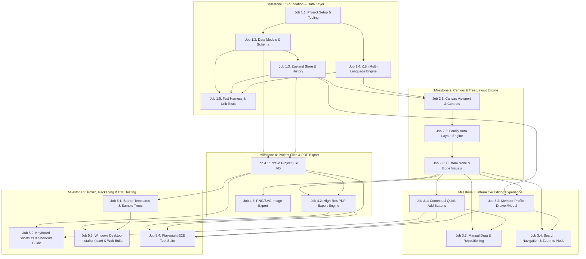

# Drevo — Simple Family Tree Application
## Design Document & Project Execution Roadmap

---

## 1. Executive Summary & Vision

**Drevo** (meaning *"Tree"*) is a lightweight, modern, and intuitive application designed to make family tree creation effortless for everyday users. 

Traditional genealogy software is often bloated, overly technical, and cumbersome to install and configure. **Drevo** focuses on:
- **Extreme ease of use**: One-click relations (*"Add Parent"*, *"Add Child"*, *"Add Spouse"*, *"Add Sibling"*), fluid visual canvas, and zero confusing jargon.
- **Frictionless installation**: Single-command or zero-install web app / PWA that runs anywhere (Windows, macOS, Linux, tablet) directly in the browser with offline capability.
- **Native project files**: Simple `.drevo` JSON-based project files for saving, loading, versioning, and sharing.
- **Print-ready PDF export**: Clean, high-resolution vector/canvas PDF exports formatted for standard paper sizes (A4, A3, Poster) with customizable titles and layouts.

---

## 2. Target Features & Specifications

### 2.1 Person & Relationship Management
- **Individual Details**: First/Middle/Last names, maiden name, gender/marker, birth date & place, death date & place (optional alive/deceased toggle), avatar/photo, short biography/notes.
- **Smart Relations**:
  - Direct parent-child connections (biological, adoptive).
  - Partnerships / Marriages (current, separated, divorced) with union nodes.
  - Siblings (automatically resolved through shared parents).
- **Fast Actions Toolbar / Node Handles**: Hovering a person card reveals directional `+` buttons to immediately generate and link relatives.

### 2.2 Interactive Canvas & Auto-Layout
- **Fluid Viewport**: Smooth zoom, pan, mini-map, and grid snapping.
- **Hybrid Layout**:
  - *Auto-Layout Mode*: Generational layering (Dagre/hierarchical tree algorithm) keeps lines clean, prevents overlapping, and groups spouses side-by-side.
  - *Manual Mode*: Drag and reposition any branch or node when custom artistic adjustments are desired.
- **Visual Clarity**: Color-coded generation markers, elegant branch line curves, and collapsible branches for large trees.

### 2.3 Project File System (`.drevo`)
- **Format**: Human-readable, portable JSON with the `.drevo` file extension.
- **Storage**:
  - Browser File System Access API (native *Open*, *Save*, *Save As* dialogs).
  - Fallback file download/upload for all browsers.
  - LocalStorage / IndexedDB auto-save to safeguard ongoing edits against accidental tab closures.
- **Schema**:
  ```json
  {
    "version": "1.0.0",
    "metadata": {
      "title": "Smith Family Heritage",
      "author": "Jane Smith",
      "createdAt": "2026-11-01T18:30:00Z",
      "updatedAt": "2026-11-01T18:45:00Z"
    },
    "settings": {
      "layout": "hierarchical",
      "theme": "classic"
    },
    "persons": [
      {
        "id": "p_01",
        "firstName": "John",
        "lastName": "Smith",
        "birthDate": "1950-04-12",
        "deathDate": null,
        "isDeceased": false,
        "notes": "",
        "photoUrl": null,
        "position": { "x": 100, "y": 200 }
      }
    ],
    "unions": [
      {
        "id": "u_01",
        "partnerIds": ["p_01", "p_02"],
        "childrenIds": ["p_03"],
        "marriageDate": "1975-06-20"
      }
    ]
  }
  ```

### 2.4 PDF & Image Export Engine
- **PDF Customization**:
  - Page sizes: A4, A3, Letter, Tabloid, or Auto-Fit Single Page (Poster).
  - Orientation: Landscape (standard for broad family trees) or Portrait.
  - Margins, tree title header, generation labels, author credit, and generation date watermark.
- **Format Output**:
  - Crisp Vector PDF (via `jsPDF` + SVG rasterizer) so text and lines remain sharp when printed.
  - High-res PNG / SVG export for digital sharing and web embedding.

### 2.5 Internationalization (i18n) & Localization
- **Supported Languages at Launch**:
  - **English (`en`)**: Default language.
  - **Slovenian (`sl`)**: Complete native Slovenian translation (*Drevo*, *Oče*, *Mati*, *Sin*, *Hči*, *Zakonca*, *Dodaj sorodnika*, etc.).
  - **Debug / Pseudo-Localization Mode (`debug`)**:
    - Wraps text in identifiable delimiters and diacritics (e.g., `[!! Ďŕévóó !!]`).
    - Flashes an unmissable warning tag (`⚠️MISSING: key_name⚠️`) if any UI element or setting is untranslated or missing a key.
    - Enables instantaneous visual QA to verify 100% translation coverage.
- **Language Switcher**: Fast dropdown in the top navigation / settings bar, persisting user choice to local storage.

---

## 3. Technology Stack & Architectural Decisions

| Layer | Choice | Rationale |
| :--- | :--- | :--- |
| **Desktop Shell** | Tauri (Rust + WebView2) | Native Windows `.exe` installer, tiny binary (~3–5 MB), ultra-low RAM usage, native file dialogs. |
| **Web Runtime & Build** | Node.js 22 + Vite | Instant dev feedback, modular frontend that can be hosted on the web later with zero rewrites. |
| **UI Framework** | React 19 + TypeScript | Strong type safety for complex graph data models and rich ecosystem. |
| **Styling & Components** | Tailwind CSS + Lucide Icons | Clean, modern UI with minimal custom CSS overhead. |
| **Interactive Canvas** | @xyflow/react (React Flow) / SVG Canvas | Proven node-based viewport with built-in zoom/pan, custom nodes, and edge routing. |
| **Tree Auto-Layout** | Dagre / ELK.js | Deterministic hierarchical layout engine suited for multi-generational trees. |
| **State Management** | Zustand + Immer | Lightweight state store, minimal boilerplate, built-in undo/redo history. |
| **Internationalization (i18n)** | i18next + react-i18next | Multi-language engine (EN, SL), missing-key fallback indicators, and pseudo-localization debug mode. |
| **PDF Generation** | jsPDF + html-to-image | High-resolution PDF rendering with zero server dependency. |

---

## 4. Milestones & Jobs Breakdown

The project is structured into **5 sequential Milestones** containing discrete **Jobs**. Each job lists its dependencies/prerequisites.



---

### Detailed Job Descriptions

#### Milestone 1: Foundation & Data Layer — ✅ COMPLETED
*Goal: Establish project baseline, types, data schemas, reactive state management, and multi-language engine.*

- **Job 1.1: Project Setup & Tooling** — ✅ Done
  - **Prerequisites**: None
  - **Deliverables**: Vite + React 19 + TypeScript + Tailwind CSS setup with Tauri desktop shell configured. Path aliases, linting, and Lucide icon suite installed.
- **Job 1.2: Data Models & Schema Definition** — ✅ Done
  - **Prerequisites**: Job 1.1
  - **Deliverables**: TypeScript interfaces for `Person`, `Union`, `RelationshipType`, `TreeProject`, and `.drevo` file schema with Zod validation.
- **Job 1.3: Zustand Store & History (Undo / Redo)** — ✅ Done
  - **Prerequisites**: Job 1.2
  - **Deliverables**: Global tree store handling add/edit/delete for persons and unions, with temporal middleware for seamless Undo/Redo (`Ctrl+Z` / `Ctrl+Y`) and local auto-save.
- **Job 1.4: Internationalization (i18n) Engine (EN, SL, Debug Mode)** — ✅ Done
  - **Prerequisites**: Job 1.1
  - **Deliverables**: Multi-language support with English (`en`), Slovenian (`sl`), and Debug/Pseudo-localization mode (`debug`). Shows visual warnings (`⚠️MISSING: key⚠️`) for any untranslated string and allows instant language toggling.
- **Job 1.5: Test Harness & Core Unit Tests** — ✅ Done
  - **Prerequisites**: Job 1.2, Job 1.3, Job 1.4
  - **Deliverables**: Vitest + React Testing Library environment setup. Unit tests for schema validation, person/union relational rules, Zustand store state transitions, and i18n translation key parity checks.

---

#### Milestone 2: Canvas & Tree Layout Engine — ✅ COMPLETED
*Goal: Display family relations in a smooth, readable, interactive canvas.*

- **Job 2.1: Canvas Viewport & Controls** — ✅ Done
  - **Prerequisites**: Job 1.3
  - **Deliverables**: React Flow canvas with Pan, Zoom (mouse wheel & UI controls), Fit-to-Screen button, keyboard zoom +/- controls, and subtle grid background with snap-to-grid.
- **Job 2.2: Family Auto-Layout Engine** — ✅ Done
  - **Prerequisites**: Job 2.1
  - **Deliverables**: Algorithmic generation layout engine (hierarchical layout positioning generations top-to-bottom, grouping married pairs horizontally, chronological sibling birth-year sorting, and distributing children below parents).
- **Job 2.3: Custom Node & Edge Visuals** — ✅ Done
  - **Prerequisites**: Job 2.2
  - **Deliverables**: Polished Person Cards (displaying name, lifespan `1920 – 1995`, maiden name, generation Roman badge `Gen I/II/III`, gender accent, avatar) and marriage connector labels (💍 year).

---

#### Milestone 3: Interactive Editing Experience — ✅ COMPLETED
*Goal: Allow users to build out family branches with minimal clicks.*

- **Job 3.1: Contextual Quick-Add Buttons** — ✅ Done
  - **Prerequisites**: Job 2.3
  - **Deliverables**: Hover / selection menu on person cards: `+ Add Parent`, `+ Add Child`, `+ Add Spouse`, `+ Add Sibling`. Automatically creates nodes, links unions, and adjusts layout.
- **Job 3.2: Member Profile Drawer / Modal** — ✅ Done
  - **Prerequisites**: Job 1.3, Job 2.3
  - **Deliverables**: Side panel for editing full details: First, Middle, Last names, Maiden name, Birth/Death dates & locations, alive/deceased toggle, and biographical notes.
- **Job 3.3: Manual Drag & Repositioning** — ✅ Done
  - **Prerequisites**: Job 2.3, Job 3.1
  - **Deliverables**: Ability to drag nodes freely or snap-to-grid, saving custom coordinates while keeping connector lines dynamically attached.
- **Job 3.4: Search, Navigation & Zoom-to-Node** — ✅ Done
  - **Prerequisites**: Job 2.3, Job 3.2
  - **Deliverables**: Top search bar with auto-complete to instantly find any person and smoothly animate camera zoom to their position.

---

#### Milestone 4: Project Files & PDF Export — ✅ COMPLETED
*Goal: Ensure project persistence and beautiful printing.*

- **Job 4.1: `.drevo` Project File I/O** — ✅ Done
  - **Prerequisites**: Job 1.2, Job 1.3
  - **Deliverables**: "New Project", "Open Project (.drevo / .json)", "Save", and "Save As". Support File System Access API with standard fallback download.
- **Job 4.2: High-Res PDF Export Engine** — ✅ Done
  - **Prerequisites**: Job 2.3, Job 4.1
  - **Deliverables**: PDF export modal with preview, paper size selection (A4, A3, Letter, Poster), orientation toggle (Landscape/Portrait), custom title header, date stamp, and multi-page or single-page fit.
- **Job 4.3: PNG / SVG Image Export** — ✅ Done
  - **Prerequisites**: Job 2.3
  - **Deliverables**: 1-click snapshot export of the current canvas or full tree as crisp PNG image download.

---

#### Milestone 5: Polish, Packaging & E2E Testing
*Goal: Deliver a delightful, frictionless out-of-the-box user experience backed by comprehensive tests.*

- **Job 5.1: Starter Templates & Sample Trees** — ✅ Done
  - **Prerequisites**: Job 4.1
  - **Deliverables**: Pre-packaged example trees (3-generation sample Novak family) and empty starter templates so users can immediately test all features.
- **Job 5.2: Keyboard Shortcuts & Shortcuts Guide** — ✅ Done
  - **Prerequisites**: Job 3.1, Job 4.1
  - **Deliverables**: Keybindings for common actions (`Ctrl+S` Save, `Ctrl+Z` Undo, `Ctrl+Y` Redo, `+`/`-` Zoom, `0` Fit, `?` Shortcuts Guide modal).
- **Job 5.3: Windows Desktop Installer (.exe) & Web Build**
  - **Prerequisites**: Job 4.2, Job 5.1
  - **Deliverables**: Tauri desktop release bundle (`Drevo-Setup.exe` installer with custom app icon and `.drevo` file association) + standalone web build target ready for static hosting.
- **Job 5.4: Playwright End-to-End (E2E) Test Suite**
  - **Prerequisites**: Job 3.1, Job 3.2, Job 4.1, Job 4.2
  - **Deliverables**: Automated Playwright browser tests covering full user workflows: tree creation, relation linking, profile edits, i18n language toggling, project file save/reload verification, and PDF generation smoke test.
- **Job 5.4: Playwright End-to-End (E2E) Test Suite**
  - **Prerequisites**: Job 3.1, Job 3.2, Job 4.1, Job 4.2
  - **Deliverables**: Automated Playwright browser tests covering full user workflows: tree creation, relation linking, profile edits, i18n language toggling, project file save/reload verification, and PDF generation smoke test.

---

## 5. Verification & Acceptance Criteria

1. **Installation & Startup**: Launches cleanly with `npm run dev` or single web click; zero configuration required.
2. **Speed & Usability**: A new user can create a 3-generation family tree (grandparents, parents, children) in under 2 minutes.
3. **File Persistence**: Saving to a `.drevo` file and reopening it on a fresh session restores 100% of the nodes, positions, and connections.
4. **PDF Quality**: Exported PDF renders without clipped labels, with correct margins, clear connector lines, and accurate text.
5. **Test Coverage**: All unit, integration, and E2E test suites pass in CI / automated check (`npm test`).

---

## 6. Comprehensive Testing Architecture

To guarantee long-term stability and prevent regressions as the app grows, Drevo employs a 4-tier testing strategy:

### 6.1 Unit Testing (Vitest)
- **Data Models & Zod Validation**: Validates schema parsing, required fields, date formats, and error handling for malformed data.
- **Graph & Tree Algorithms**:
  - Cycle prevention (guards against circular ancestry).
  - Multi-generational layer assignment (great-grandparents -> grandparents -> parents -> children).
  - Sibling & partner sorting logic.
- **State Store & Undo/Redo**: Tests state transitions for `addPerson`, `updatePerson`, `deletePerson` (cascading removal of dangling relationship nodes), and verifying history snapshots roll back and forward accurately.
- **i18n Translation Parity**: Automated unit test ensuring 100% key parity between `en.json` and `sl.json`, instantly failing if a new key is added without its Slovenian counterpart.

### 6.2 Component & Integration Testing (Testing Library + Vitest)
- **PersonCard Component**: Checks node rendering, lifespan formatting (`1950 – Present`), gender styling, and verifies quick-add triggers call the appropriate store actions.
- **ProfileDrawer Component**: Tests form input behavior, date pickers, validation error messages, and save actions.
- **Search & Navigation**: Verifies name queries filter correctly and trigger camera focus callbacks.
- **Project Serialization Roundtrip**: Serializes a complex 4-generation tree to `.drevo` JSON string, parses it back, and deep-asserts exact state equality.

### 6.3 PDF & Visual Smoke Testing
- **PDF Export Engine**: Tests page layout calculations, orientation switching, header/footer rendering, and validates valid PDF byte output without memory leaks.
- **Canvas Visual Bounds**: Tests tree bounding-box computation to guarantee no nodes are cut off during export.

### 6.4 End-to-End (E2E) Testing (Playwright)
- **Core User Journey**:
  1. Boot app from clean state.
  2. Add root person "Ana Novak".
  3. Use quick-action to add spouse "Marko Novak" and two children.
  4. Edit child details in profile drawer.
  5. Switch language to Slovenian -> verify all UI labels update.
  6. Switch language to Debug mode -> verify pseudo-localization delimiters `[!! ... !!]`.
  7. Export `.drevo` project file -> clear canvas -> re-open file -> verify exact tree layout restored.
  8. Trigger PDF export modal and generate PDF download.
